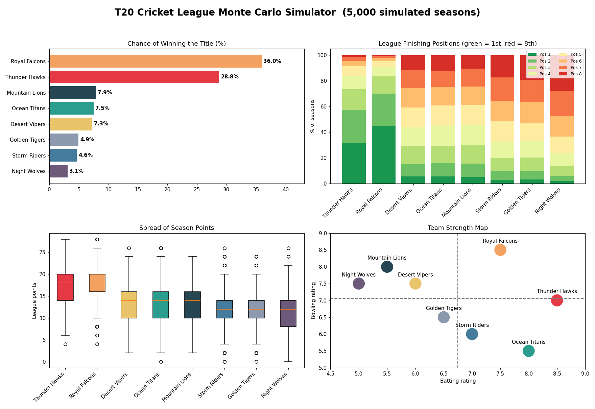

# T20 Cricket League Monte Carlo Simulator

A single-file **R** project that predicts who will win a T20 cricket league by simulating the whole season **5,000 times** instead of guessing.

Eight fictional teams, each with batting and bowling ratings, play a double round-robin league (56 matches), followed by semi-finals and a final. Repeating the season thousands of times gives each team's real chances of winning the title, reaching the top 4, and how many points they typically earn.



## Features

- Match engine where expected score depends on a team's batting vs the opponent's bowling
- Full league table with points and run-difference tiebreaker
- Semi-finals (1st v 4th, 2nd v 3rd) and a final
- Monte Carlo analysis: title odds, top-4 odds, average points, finishing-position distribution
- Saves 4 charts and a CSV summary to an `output/` folder
- Uses **base R only**, so there are no packages to install

## Requirements

- [R](https://cran.r-project.org/) 4.0 or newer

## How to run

```bash
Rscript cricket_league_simulator.R
```

Or open the file in VS Code (with the R extension) and run **R: Source Active File**.

The script prints a sample season and the final probabilities in the console, then writes everything to `output/`.

## Output files

| File | Description |
|------|-------------|
| `1_title_probability.png` | Chance of winning the title for each team |
| `2_position_distribution.png` | How often each team finishes in each league position |
| `3_points_spread.png` | Spread of season points across all simulations |
| `4_team_strength_map.png` | Batting vs bowling rating of each team |
| `league_simulation_summary.csv` | Summary table of all results |

## Customize it

- Edit the `teams` data frame to use your own team names and ratings
- Change `n_sims` for more or fewer simulated seasons
- Tweak the score formula in `play_match()` to make matches more or less random

## License

MIT
